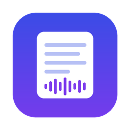
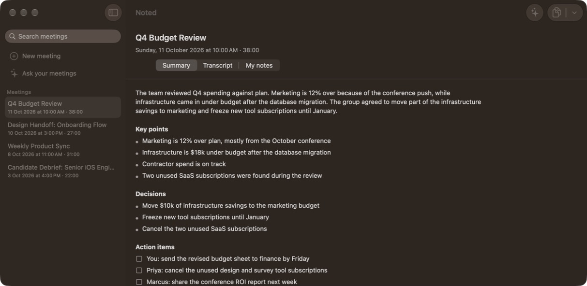
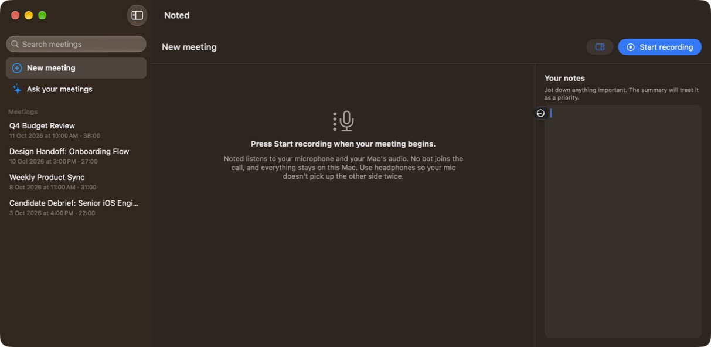
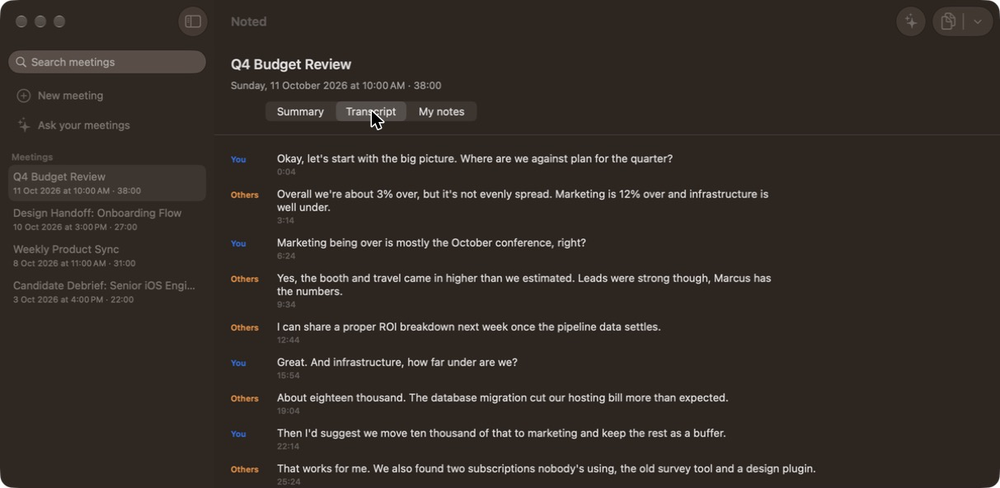
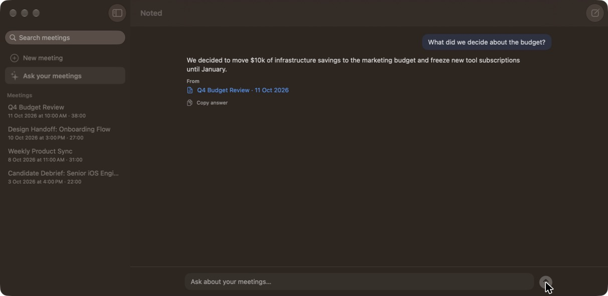

  

<h1 align="center">Noted</h1>

  <b>Private AI meeting notes for macOS.</b> 
  Records your calls, transcribes them live, writes the summary and answers questions about them,
  all on your Mac. No bot joins the meeting, and nothing leaves your computer.

  
  
  
  

  

## Install

  

Requires a Mac with **Apple silicon** and **macOS 26** or later. Summaries and Ask need **Apple Intelligence** turned on.

1. Download **Noted-x.y.zip** (or **.dmg**, when a release has one) from the [latest release](https://github.com/poojarysanjay05-oss/noted/releases/latest).
2. Double-click the zip to unzip it, then move **Noted** into **Applications**. For a DMG, open it and drag Noted onto the Applications shortcut.
3. Open Noted from Applications. The first time you press **Start recording**, allow **Microphone** and **Screen & System Audio Recording** access (see [First recording](#first-recording)).

### "Apple could not verify Noted…"

Noted isn't signed with a paid Apple Developer ID yet, so macOS asks you to confirm the first time:

1. Open Noted once and click **Done** on the warning.
2. Open **System Settings → Privacy & Security** and scroll down to the **Security** section.
3. Next to *"Noted" was blocked to protect your Mac*, click **Open Anyway**, then confirm with your password or Touch ID.

You only need to do this once per version. After an update, macOS may also ask again for Microphone and Screen & System Audio Recording access.

## What it does

Noted listens to your **microphone** (you) and your **Mac's audio** (everyone else on Zoom, Google Meet, Teams or any other app). It turns both into a live transcript labelled **You** and **Others**. After the meeting, click **Generate summary** and Apple Intelligence writes the minutes for you.

- 🎙️ **Live transcription, no bot.** Uses Apple's on-device speech recognition. Nobody gets a "Noted has joined" message.
- ✨ **One-click summaries.** An overview, key points, decisions and action items, plus a short title.
- 📝 **Your notes count.** Jot notes beside the live transcript, and the summary treats them as the priorities.
- 💬 **Ask your meetings.** "What did we decide about the budget?" or "What did others ask me to follow up on last week?" Answers link to the meetings they came from.
- 🔍 **Search everything.** Titles, summaries, notes and full transcripts, with a snippet of each match.
- ⌨️ **Start from anywhere.** <kbd>⌃</kbd><kbd>⌥</kbd><kbd>R</kbd> starts or stops recording in any app. A menu bar icon shows when you're recording.
- 🛟 **Never lose a meeting.** Saves every few seconds and recovers meetings after a crash, quit or restart.
- 🌊 **Live audio meters.** See that Noted can hear both you and the call.
- 📋 **Copy what you need.** Copy just the summary, the transcript or your notes, or everything as Markdown.
- 🪟 **Fits beside your call.** The layout adapts from a narrow side window to full screen.

## Screenshots

| New meeting | Transcript |
|---|---|
|  |  |

| Summary | Ask your meetings |
|---|---|
|  |  |

Screenshots use made-up sample meetings.

## Privacy

Everything happens on your Mac:

| | How |
|---|---|
| Audio capture | ScreenCaptureKit (system audio) and your microphone. Audio is never uploaded. |
| Transcription | Apple's on-device `SpeechAnalyzer` / `SpeechTranscriber` |
| Summaries and answers | Apple Intelligence's on-device model (`FoundationModels`) |
| Storage | A local SwiftData database in the app's sandbox |

There are no accounts, no servers and no analytics.

## Requirements

- A Mac with **Apple silicon**
- **macOS 26** (Tahoe) or later
- **Apple Intelligence** turned on (System Settings → Apple Intelligence & Siri) for summaries and Ask

## First recording

1. Press **Start recording** (or <kbd>⌃</kbd><kbd>⌥</kbd><kbd>R</kbd>).
2. Allow **Microphone** access.
3. Allow **Screen & System Audio Recording** (System Settings → Privacy & Security). This is how Noted hears the other people on a call. Quit and reopen Noted after allowing it.
4. The first time, macOS downloads its on-device speech model. This happens once.

> **Tip:** use headphones. Otherwise your mic also picks up the other people, and their words appear under "You" as well.

## Keyboard shortcuts

| Shortcut | Action |
|---|---|
| <kbd>⌃</kbd><kbd>⌥</kbd><kbd>R</kbd> | Start or stop recording from any app |
| <kbd>⇧</kbd><kbd>⌘</kbd><kbd>R</kbd> | Start or stop recording on the New meeting screen |

## How it's built

| File | What it does |
|---|---|
| `Noted/Audio/AudioCapture.swift` | ScreenCaptureKit: system audio (Others) and microphone (You) as separate streams |
| `Noted/Audio/LiveTranscriber.swift` | Live on-device speech-to-text with `SpeechAnalyzer` |
| `Noted/Audio/AudioLevels.swift` | Loudness history for the live waveform |
| `Noted/RecordingSession.swift` | Start/stop, live transcript, saving as it goes, crash recovery |
| `Noted/Summarizer.swift` | Structured summaries with `FoundationModels`; long meetings are condensed in chunks first |
| `Noted/Ask/MeetingSearch.swift` | Finds the excerpts most relevant to a question (keywords, on-device sentence embeddings, dates like "last week") |
| `Noted/Ask/AskModel.swift` | Answers from those excerpts and reports which ones it used, so sources are accurate |
| `Noted/GlobalHotKey.swift` | The system-wide <kbd>⌃</kbd><kbd>⌥</kbd><kbd>R</kbd> shortcut |
| `Noted/Models.swift` | SwiftData models, search snippets and Markdown export |
| `Noted/DemoMode.swift` | A sample meeting for Debug builds |
| `Noted/Views/` | SwiftUI: sidebar, recorder, meeting view, Ask, live waveform |

### Limits

- The on-device model reads a few thousand words at a time, so Ask picks the most relevant excerpts. Questions spanning many meetings get a partial answer.
- People other than you are all labelled **Others**; there's no per-person speaker identification yet.
- Recordings keep the transcript, not the audio.

## Roadmap

- [ ] Rename "Others" to real names, and speaker identification
- [ ] Send action items to Reminders
- [ ] Detect Zoom, Meet and Teams calls and offer to start
- [ ] Calendar integration for titles and attendees
- [ ] Summary templates (stand-up, 1:1, interview, sales call)
- [ ] Optional audio recording with click-to-play transcript

## License

[MIT](LICENSE) © 2026 Sanjay Poojary
